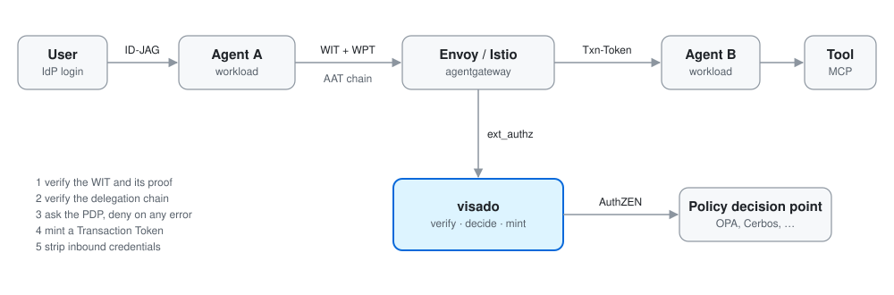

<picture>
  <source media="(prefers-color-scheme: dark)" srcset="docs/assets/lockup-dark.svg">
  
</picture>

[](https://github.com/kanywst/visado/actions/workflows/ci.yml)
[](https://scorecard.dev/viewer/?uri=github.com/kanywst/visado)
[](LICENSE)

visado is an ext_authz service for AI agent traffic that runs behind Envoy, Istio or agentgateway. For each request it verifies the caller's workload credential and the delegation chain behind the request, asks an [AuthZEN](https://openid.net/specs/authorization-api-1_0.html) policy decision point, and passes the verified chain downstream as an [OAuth Transaction Token](https://datatracker.ietf.org/doc/draft-ietf-oauth-transaction-tokens/).

> [!IMPORTANT]
> visado is pre-alpha and implements Internet-Drafts that are still changing. AAT is the only delegation-chain format so far. See the [roadmap](ROADMAP.md).

## How it fits

<picture>
  <source media="(prefers-color-scheme: dark)" srcset="docs/assets/flow-dark.svg">
  
</picture>

It follows the composition in [draft-ietf-wimse-aims](https://datatracker.ietf.org/doc/draft-ietf-wimse-aims/). It does not issue identities, log users in, evaluate policy or route traffic; see [docs/scope.md](docs/scope.md).

## Components

| Component | Spec | Status |
| --- | --- | --- |
| [`visado-txn-token`](crates/txn-token) | draft-ietf-oauth-transaction-tokens-11 | alpha: mint, verify, replace, request parsing, conformance vectors |
| [`visado-credentials`](crates/credentials) | WIMSE WIT and WPT via [wimsey](https://github.com/kanywst/wimsey), OAuth access tokens | alpha; HTTP signatures, mTLS and SVIDs planned |
| [`visado-authzen`](crates/authzen) | AuthZEN 1.0 | alpha: evaluation and discovery; batch and search not used |
| [`visado-extauthz`](crates/extauthz) | Envoy ext_authz v3 | alpha |
| [`visado`](crates/server) | | alpha: server binary |
| [`visado-chain`](crates/chain) | | alpha: normalized chain model and decoder trait |
| [`visado-chain-aat`](crates/chain-aat) | draft-niyikiza-oauth-attenuating-agent-tokens-02 | alpha: §8 verification, 229/229 published vectors, enforced by the gate |
| Delegation chains (asor, RFC 8693 `act`) | see [SPEC-MAP.md](SPEC-MAP.md) | planned |
| Chain view, OpenTelemetry | | planned |

## Try it

```bash
git clone https://github.com/kanywst/visado
cd visado
cargo test --workspace
cargo run -p visado -- deploy/local/visado.toml
```

To see it behind Envoy with a real PDP, run the [lab](deploy/lab/): `docker compose up -d --build && ./demo.sh` in `deploy/lab`. The Transaction Token conformance vectors in [conformance/](conformance/) can be used to test other implementations; the AAT vectors there are a copy of the suite from [tenuo-ai/tenuo](https://github.com/tenuo-ai/tenuo).

## Documentation

- [docs/scope.md](docs/scope.md): what visado covers and what it leaves to other projects
- [docs/design.md](docs/design.md): request pipeline and plugin interfaces
- [SPEC-MAP.md](SPEC-MAP.md): pinned draft revisions and known divergences
- [docs/research/](docs/research/): background research

## Contributing

See [CONTRIBUTING.md](CONTRIBUTING.md). Commits need a DCO sign-off. visado follows the [CNCF Code of Conduct](CODE_OF_CONDUCT.md).

## Security

Do not open a public issue for a vulnerability. Follow [SECURITY.md](SECURITY.md).

## License

[Apache-2.0](LICENSE)
